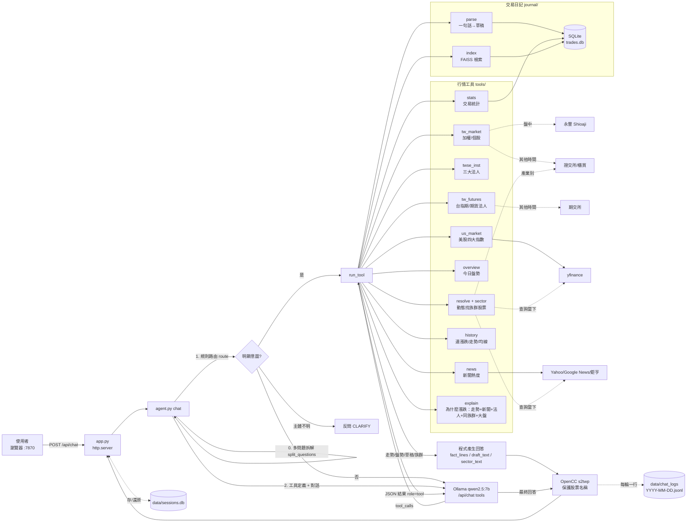

# trade-coach 運作原理（面試說明用）

> 個人交易教練：用對話記錄買賣，查台股／台指期／美股／新聞，並用「程式算的統計＋日記檢索」檢討策略。
> 全部在本機跑：Ollama `qwen2.5:7b`（RTX 4070 12GB）、SQLite、FAISS。
> 行號以目前版本為準，改程式後可能會偏移。

---

## 1. 整體架構

分三層：
- **工具層（tools/）**：抓資料、算數字，每個函式都回傳 dict，而且都有 `source`、`as_of`。
- **知識層（journal/）**：交易紀錄、心得存 SQLite；心得和交易理由建 FAISS 索引給檢索用。
- **對話層（agent.py + app.py）**：模型決定要叫哪些工具，再根據工具結果組織回答。

核心原則：**模型不算數字、不編數字**。數字都來自工具輸出，模型只負責挑工具和解釋。

---

## 2. 一則訊息的處理流程

`agent.py` 的 `chat()`（約第 979 行）：

1. **組 prompt**：系統提示 `SYSTEM`（第 83 行，含今天日期、13 條規則）＋最近 `HISTORY_TURNS = 10` 輪對話＋這次的訊息。有待確認的交易草稿時，會把草稿附在系統提示後面。
2. **草稿確認／取消由程式處理**：session 有草稿，而訊息符合 `CONFIRM_WORDS`（第 80 行，例如「確認」「好」「存」）時，直接呼叫 `confirm_pending()` 存檔，**不經過模型**。「取消」也一樣。
3. **規則路由 `route(text, session)`**（第 296 行）：用正規表示式判斷意圖，先把對應的工具叫好（見 2.1）。原因：評測時發現 7B 模型常常**沒叫工具就直接給數字**（例如自己編費半點數）。
4. **程式直接回答**（第 1075 行附近）：以下幾類由程式產生回覆，不經過模型：
   - 記交易的草稿：`draft_text()`（第 427 行）
   - 連漲連跌／走勢／均線／52 週高低：`code_answer()`（第 484 行）→ `history.fact_lines()`
   - 今日盤勢：`code_answer()` 把 `summary_lines` 條列，並註明是每日收盤還是即時
   - 主體不明的追問（例如一開頭就問「跌幾天了」）：回 `CLARIFY`（第 220 行）反問「你是問哪一個？」，**不在沒有資料的情況下回答**
5. **模型工具呼叫迴圈**（第 1096 行）：其他問題交給模型，見第 3 節。
6. **防編造**：模型沒叫任何工具，卻講出對話裡沒出現過的數字時，會要求它「先呼叫工具」再答一次；仍然沒有工具資料的話，回覆後面加註「數字可能不可靠」。有叫工具時，`unverified_numbers()`（第 575 行）會比對回覆裡每個數字是否出現在工具輸出（容許億／萬／張換算與四捨五入），找不到的會在回覆後加註「可能是模型自行計算」。
7. **去掉客套話**：`FILLER_RE`（第 571 行）刪掉「請確認是否需要檢視更多資料」「需要更多資訊嗎」這類句子；系統提示也規定第一句要直接回答，不能加沒有資料支持的解讀（例如「多頭勢能」）。
8. **轉繁體**：`to_tw()`（第 66 行）用 OpenCC `s2twp`。轉換前先把股票名稱換成佔位符，轉完再換回來（OpenCC 會把「富采」改成「富採」、「台積電」改成「臺積電」），最後把「臺」統一成「台」。

### 2.1 路由與追問（主題記憶）

- **主體 `_entity()`**（第 182 行）：費半／那斯達克／道瓊／標普 → 美股指數代號；股票名稱或代號 → 個股；「台股／大盤／加權」→ TAIEX；「美股」→ 四大指數。
- **歷史類關鍵字 `HIST_RE`**（第 157 行）：連跌、連漲、幾天、多天、一直跌、這週、最近、走勢、均線、高點、低點、52 週……
  - 問題重點 `_focus()`：streak（連漲跌）／week（本週）／high（52 週高低）／ma（均線）／trend（走勢）。
  - 有主體 → 呼叫 `us_index_history` 或 `tw_history`。
- **Session.topic**：每次路由後，`_update_topic()`（第 458 行）記下 `{entity, intent, focus}`。
  - 「費半連跌幾天了」→ topic = (^SOX, us_index_history)
  - 接著問「跌幾天了」（沒有主體）→ 沿用 ^SOX
  - 「那台股呢」（追問句型 `FOLLOW_RE`：開頭是「那」或結尾是「呢」）→ 沿用上一題的意圖（歷史走勢），主體換成 TAIEX → `tw_history`
  - 「外資呢」→ 有自己的關鍵字，直接叫 `get_institutional`
  - 沒有 topic 又沒有主體 → 反問
- **族群／主題／不認識的名稱 `_theme_query()`**（第 235 行）：把市場字（美股／台股）和問句字（跌多慘、表現、今天、呢…）去掉，剩下的就是主題或公司名稱。
  - 有「概念股／族群／類股／股」、有指定市場、在查詢翻譯表上、或是英文名稱 → 直接走 `sector_performance`，而且**優先於**歷史與追問判斷（修掉「美股光通訊呢」被當成「美股四大指數」追問的 bug）。
  - 指數名稱和台股個股（證交所／櫃買公司資料裡有的）不算主題，交給原本的路由。
  - 其他工具都沒對到、但剩下一個不認識的名稱（例如「輝達今天表現如何」）→ 也走 `sector_performance`。
  - 追問：上一題是族群（topic = ("theme", 光通訊, us)），「那台股呢」→ 同主題換市場；「跌幾天了」→ 同主題。

### 2.2 一句話裡有好幾個問題

`split_questions()`（第 378 行）先用分隔符號（兩個以上空白、，、？、然後、還有、另外…）和單一空白切成片段，再逐段跑 `route()`：
- 有**自己的主體或自己的意圖**才算一個獨立問題；只靠上一段主題的片段（例如「最近表現」）併回前一段。
- 模擬追問主題，所以「費半連跌幾天 還有台股呢」也能拆成兩題。
- 記交易、記心得的句子不拆（「今天531買了10股聯鈞 因為突破 停損483」裡的空白不是分題）。
- 拆出 2 段以上時，`_chat_multi()`（第 955 行）每段各自走 `chat(..., _sub=True)`（規則路由／程式回答／模型），回覆依序以「【子問題】」串起來；history 和 chat log 只記一筆（`route.mode = multi`，每段的路由放在 `route.parts`）。

### 2.3 「為什麼漲／跌」：`explain_move`

起因：真實介面問「為何聯鈞跌那麼多天」，沒叫任何工具，模型回「目前沒有資料…如果需要聯鈞（2313）的每日走勢，我會呼叫 tw_history」。檢查 chat log：`_entity()` 其實有找到 3450，但 `route()` 沒有任何意圖對得上（`HIST_RE` 沒有「多天」，報價規則沒有「為何／跌」），回空清單 → 交給模型 → 模型沒叫工具、自己編了代號（聯鈞是 3450），還把工具名稱講出來。修正：

1. **實體一律先由程式找**：`route()` 最後加一條：有認得的股票／指數、但問法沒對到任何意圖 → 一定先查資料（有漲跌字就查走勢，否則查報價），不讓模型空手回答。`HIST_RE` 加上「多天、一直跌、一直漲」。走模型的回覆時，系統提示會附上「這題提到的股票：聯鈞（3450），代號以這個為準」。
2. **新意圖 why_move**（`is_why()` 第 268 行）：`WHY_RE`（為何／為什麼／怎麼會／怎麼了／原因／幹嘛…）加上漲跌字（漲、跌、崩、噴、一直、那麼多…），或單獨的「怎麼了／怎麼回事」。講停損、勝率、賺賠、交易的不算（那是日記問題）。`_why_target()`（第 272 行）先用 `_entity()`（公司清單、指數名稱），找不到才把疑問詞拿掉、用剩下的名稱（例如「輝達」交給 resolver），再不行沿用上一題主體。
3. **`explain_move(target)`**（`tools/explain.py` 第 322 行）平行抓：
   - 走勢：`history.tw_history`／`us_index_history`／yfinance 日 K，連漲連跌、最近 10 天漲跌天數、5／20 日。
   - 新聞：Google 新聞 RSS「名稱 when:7d」（美股另加英文 Google News 和 yfinance 新聞），只留**標題有提到它**的，去掉個股頁、論壇貼文、YouTube，附時間、媒體和連結（網頁上顯示成「連結」）。
   - 法人（台股個股）：最近 5 個交易日外資／投信／自營商買賣超（張）。上市用證交所 T86，上櫃用櫃買 dailyTrade；每天的整份資料快取在 `data/inst_cache/`，再算連買／連賣天數與合計。
   - 同族群：台股用「新聞標題和它一起出現 ≥2 次的股票」（不足 3 檔才用同產業別資本額大的補）；美股用 yfinance 同產業前幾大；美股指數用其他三大指數。
   - 大盤／美股：台股看加權指數，科技類產業另看費半、那斯達克；美股看 S&P 500、那斯達克（半導體加費半）。
   - `signals()`（第 376 行）由程式產生「可能原因的候選」，每條都帶數字：同族群是否一起跌、法人連賣幾天合計幾張、費半是否也連跌、近 7 天新聞（沒有新聞就明講）。
   - 不是單一股票或指數（例如「光通訊為什麼跌」）→ 改回族群表現（`sector_performance`），並說明要看原因請指定個股。
4. **回答 = 程式寫事實＋模型只寫「可能原因」**（`explain_answer()` 第 732 行、`why_reasons()` 第 667 行）：事實段落由 `explain.fact_text()` 產生。模型只拿到 signals 和新聞標題，寫 2–3 點，每點要用【走勢／同族群／法人／大盤／美股／新聞】標出依據。`_cites()`（第 715 行）逐點檢查：每個數字（連「6 檔中 5 檔」的小數字也算）都要出現在該標籤的事實裡，而且真的引用到數字或新聞標題原文；不合格的點丟掉，不足 3 點用程式的 signals 補。標題固定寫「可能原因（根據上面的資料推論，不是確定的原因）」。
5. **不准講工具名稱**：系統提示第 13 條；模型寫的回覆一律經過 `strip_tool_names()`（第 601 行），含工具名稱或「我會呼叫／調用…」的句子整句拿掉。`fix_tickers()`（第 632 行）把「名稱（代號）」「代號 名稱」配錯的改成公司清單上的代號（聯鈞 2313 → 3450），並記 `ticker_corrected` 警告。

### 2.4 決策輔助：「適合抄底嗎」「該停損嗎」→ `decision_brief` + 14B 權衡

起因：真實對話（session b58276bffd33）裡，「適合抄底嗎」被當成族群名稱丟給 `sector_performance`（查不到）；「聯鈞現在適合抄底嗎」只回報價加一段空話，成交量還寫成「8,247 股」（其實是張）；「適合買入嗎」沒叫工具，只給籠統建議。使用者要的是**幫忙判斷**，不是報資料。

1. **新意圖 decision**（`agent.py` `DECISION_RE` 第 173 行、`is_decision` 187）：適合／該不該／可以／要不要／能不能／值得＋買／買入／加碼／攤平／抄底／接／賣／停損／停利／續抱／出場／進場，或「該停損嗎」「還能抱嗎」「怎麼操作」「怎麼辦」。在 `route()` 裡排在記交易、為什麼漲跌、族群之前（「買了／成交」這類已發生的交易不算）。
2. **主體**（現在改用 `subject_of` 284／`_decision_plan` 345，見 2.5–2.7）：句子裡的公司／代號 → 主題（族群決策）→ 去掉時間詞、狀態詞、決策詞後剩下的名稱（例如「輝達」交給 resolver）→ 上一題的主體（先問「聯鈞最近表現」再問「適合買入嗎」＝聯鈞）。都沒有就反問「你是問哪一檔？」，不硬答。
3. **`decision_brief(target)`**（`tools/decision.py` 第 272 行）全部由程式算：
   - 持倉（`position` 104）：從日記算未平倉股數、平均成本、最近一筆的停損、目標價；未實現損益、是否已跌破停損、距離停損／目標幾 %。沒有持倉就明講，並提示怎麼登錄。
   - 技術面（`technicals` 54）：MA5/10/20/60 和 5 日斜率、RSI14（Wilder）、ATR14 與 ATR%、20／60 日與 52 週高低點、52 週位置、成交量與 20 日均量（台股換成**張**）、量比、連漲連跌與 1／5／20 日漲跌。
   - 籌碼：沿用 `explain.stock_institutional`，最近 10 個交易日外資／投信／自營商連買連賣天數與合計（張）。
   - 環境：同族群、加權指數／費半／那斯達克、近 7 天新聞（沿用 `explain.py`）。
   - 事件：yfinance calendar 的下一次財報日；查不到就寫「不知道」。
   - **關鍵價位**（`build_levels` 147）：均線、20／60 日高低、52 週高低、你的成本、停損、目標，編號 L1…，標支撐／壓力和距離 %。
   - **證據清單**（`build_items` 167）：E1…，每條有類別（技術／籌碼／環境／新聞／事件／持倉）、偏多／偏空／中性、和帶數字的原文（持倉的市值、未實現損益也先算好放進 brief，回覆裡的每個數字都查得到出處），例如「收盤 457 低於 MA20 518.33（距離 -11.83%），MA20 5 日斜率 -1.33%（下降）」。
4. **14B 只做權衡**（`judge` 428、`JUDGE_SYSTEM` 356）：qwen2.5:14b 只拿到上面的證據清單和價位表，輸出 JSON：傾向（偏多／中性／偏空）、信心、最多 3 條偏多和 3 條偏空（只能填證據編號）、情境（只能填價位編號 L*）、規則檢查、觀察重點。
5. **驗證**（`judge` 裡）：證據 id 必須存在而且方向對；情境的觸發詞要和價位方向一致（現價下方的支撐只能「跌破／守住」，上方的壓力只能「站回／突破」，例如股價 457 時「站回 448」會被丟掉）；動作也要一致（跌破後不能說進場／加碼、突破後不能說不接／停損、沒有持倉不談續抱／減碼、已跌破自己的停損就不能建議續抱／加碼／抄底），情境不足兩個用程式的補；文字裡每個數字都要在 brief 裡出現（`_nums_ok` 389）；情境的價位只能是程式算出的 level，出現其他價位整條丟掉；含「需考慮多方因素」「謹慎評估」「諮詢專業」這類空話（`FILLER` 32）整條丟掉；JSON 壞掉或模型掛掉 → `code_verdict`（508）用證據數量和是否跌破停損給中性／偏多／偏空的結論。被丟掉的項目記在 log 的 `judge.dropped_n`。
6. **回覆由程式排版**（`render` 567）：第一行「結論傾向：偏空（信心：中）｜一句總結」，接著偏多／偏空理由（顯示**程式寫的證據原文**，模型只負責挑哪幾條和排序，避免它把「距離 -11.83%」說成「斜率 -11.83%」）、情境（價位由程式依 level id 填入）、你的規則檢查（`rules_check` 537，程式產生：沒有持倉、已跌破停損＝照規則出場而不是攤平、虧損部位加碼＝攤平警告、停損要大於一天正常波動 ATR）、觀察重點、關鍵價位、技術數據、一行免責。
7. **登錄既有持倉**（`split_questions` 不會把這句拆成「成本531」「停損483」好幾題）（`journal/parse.py` `parse_position` 236）：「我持有聯鈞 10股 成本531 停損483 目標570、640」用程式解析成草稿（策略標記「既有持倉」，沒講買進日就用今天並提醒），沿用記交易的「確認儲存」流程，確認前不會寫進資料庫。
8. **成交量單位**：報價工具輸出加 `volume_unit: 張`；系統提示第 14 條；模型寫的回覆經過 `fix_volume_units()`（agent.py 918），數字剛好等於工具裡成交量的「N 股」改成「N 張」。

**為什麼價位由程式算、模型只權衡？** 7B／14B 都會編價位（「支撐大概在 450 左右」），也會把數字配錯欄位。支撐壓力、停損距離、法人連賣天數都是可重現的計算，交給程式；「這些證據加起來偏多還偏空、先看哪個價位」才是需要判斷的部分，交給模型，而且只能引用編號，程式再把數字填回去。這樣模型最多是「判斷不好」，不會「數字錯」。

**顯示卡（RTX 4070，12GB）**：qwen2.5:7b（約 4.7GB）和 14b（約 9GB）放不進同一張卡，Ollama 會換模型。所以所有模型請求（agent 的 `_ollama`、`parse._ask_model`、`resolve.llm_translate`、`decision._call_judge`）都走 `tools/_common.ollama_chat()`，裡面用同一把鎖 `OLLAMA_LOCK`，一次只跑一個（也順便記錄用了哪個模型，見 8.2）；14B 用 `keep_alive=2m`，問完一陣子就自動卸載，7B 繼續負責路由和其他回答。延遲數字見第 8 節評測。

### 2.5 句子主體抽取與族群決策：「今天光通訊股票如何 值得買嗎」→ `sector_decision`

起因（真實對話）：
- 「今天光通訊股票如何 值得買嗎」：決策意圖有抓到，但主體抽取只拿掉決策詞，剩下「今天光通訊股票如何」被當成股票名稱，回「找不到，你是問哪一檔？」。
- 「光通訊現況」：`_theme_query()` 的去除清單沒有「現況」，主題變成「光通訊現況」，而 `theme_key()` 只做完全比對，所以連表上就有的「光通訊」都對不到，回報查不到。

修正：

1. **共用的主體抽取 `subject_of()`**（`agent.py` 第 284 行）：先去掉市場字（台股／美股），再去掉
   - 時間詞 `_SUBJ_TIME`（210）：今天、現在、目前、最近、本週、盤中……
   - 狀態／疑問詞 `_SUBJ_FILL`（211）：現況、近況、狀況、情況、走勢、表現、股價、如何、怎樣、怎麼樣、值得買嗎、可以買嗎……
   - 決策詞（沿用 `_DEC_STRIP`）
   - 族群標記 `_SUBJ_MARK`（255）：股票、個股、族群、類股、概念股、概念、產業、板塊、供應鏈、相關股，以及結尾的「股」（航運股 → 航運）。

   剩下的字依序判斷：
   - 剩下的就是已知主題 → 族群。已知主題用 `resolve.find_known_theme()`（第 566 行）做**子字串**比對，比對範圍是 THEME_QUERY 的 key、中文同義詞和別名，取最長的。
   - 能解析成個股：美股名稱／代號，或台股公司清單 → 個股。
   - 包含已知主題 → 族群。
   - 官方產業別名稱（航運、生技、重電 → 電機機械／電器電纜…）→ 族群。
   - 有族群標記 → 通用主題，交給 `generic_spec` 的動態解析。
   - 其他 → 未知名稱。

   只剩市場字時，「台股可以買嗎」對應加權指數，「美股」對應 S&P 500。

   例子：
   - 「今天聯鈞股票如何」→ 聯鈞（3450）
   - 「AI伺服器概念股可以買嗎」→ 主題 AI伺服器
   - 「重電族群今天怎樣」→ 主題 重電
2. **決策路由 `_decision_plan()`**（345）：
   - 個股 → `decision_brief`。
   - 族群 → `sector_decision`。
   - 未知名稱 → 先試 `decision_brief`；找不到就在 `chat()` 裡改試 `sector_decision`；再找不到才反問。
   - 句子沒有主體 → 沿用上一題主體：個股就做個股判斷，族群就做族群判斷。
   - 都沒有 → 反問。
3. **單純問現況**（`STATUS_RE` 394，在 `route()` 裡排在族群判斷前面；連跌、走勢這類歷史問題不算）：
   - 主題 → `sector_performance`（「光通訊現況」→ 光通訊）。
   - 台股個股 → `get_stock_quote` + `tw_history`，回覆由程式把報價和連漲連跌、5／20 日漲跌、均線接在一起。如果報價是上一個收盤，而 yfinance 已經有今天盤中的 K 棒，會多寫一行說明，提醒兩個價格不同。
   - `_theme_query()` 的去除清單也補上現況、近況、情形。剩下的字包含已知主題時，改用已知主題，並當作明確的主題處理。
4. **`sector_brief(theme)`**（`tools/sector_decision.py` 第 190 行）全部由程式算：
   - 族群表現：沿用 `sector.sector_performance`。內容是等權平均 1／5／20 日漲跌、漲跌家數、連漲連跌 ≥3 天的檔數、最強與最弱的成員。
   - 法人（`_members_inst` 62）：台股成員最多 8 檔，最近 5 個交易日外資和投信合計（張），以及連買／連賣的檔數。
   - 新聞熱度（`_news_heat` 44）：近 7 天 Google 新聞裡標題含主題字的則數（已去重），附最新一則的連結。
   - 大盤（`_index_ctx` 96）：台股看加權指數加費半，美股看 S&P 500 加費半。
   - 候選（`_candidates` 111）：5 日表現最強的 3 檔，各自跑 `decision.decision_brief` 和 `code_verdict`，得到各自的傾向、最近支撐／壓力、一條偏多理由和一條偏空理由。
   - 證據清單 `build_items`（141）：每條有編號 E1…、偏多／偏空／中性，並帶數字。
5. **14B 只權衡、程式驗證**：
   - `judge_sector`（270）用 `SECTOR_SYSTEM`（218），透過 `decision._call_judge(system=..., purpose="族群判斷")`，共用同一把模型鎖、keep_alive 2m。
   - 模型輸出 JSON：族群傾向、信心、偏多／偏空證據編號、一句總結、觀察重點。
   - 驗證規則跟個股決策一樣：id 要存在而且方向對、文字裡的數字都要在 brief 裡、空話整條丟掉。
   - 驗證不過就用 `code_verdict_sector`（248）：偏多條數減偏空條數，±2 決定傾向；每個類別先挑一條，避免理由全是同一類。
6. **回覆**（`render_sector` 303）：
   - 第一行：「結論傾向：偏空（信心：中）｜…」。
   - 第二行明寫：「這是「光通訊」族群的整體看法：台股 8 檔等權平均，截至 10/19 盤中／收盤；不是單一個股的買賣建議。」
   - 接著依序列出：族群表現、最強／最弱、偏多／偏空理由（顯示程式寫的原文）、法人、新聞熱度、前 3 檔候選的簡易判斷，並提示「想看單一檔的完整判斷，可以問「光聖適合買嗎」」，最後是觀察重點和資料來源。
7. **盤中還是收盤**：交易時段內，yfinance 日 K 的最後一根是「今天還沒收盤」的。`_common.bar_label()`（第 168 行）會判斷這種情況，標成「盤中」。台股以 14:30 前、日期是今天為準；美股以美東 9:30–16:00 為準。套用的地方：
   - 族群表現（`group.intraday`、`data_type`）
   - 個股走勢 `fact_lines`：「最新價」取代「收盤」
   - 決策回覆的「截至 … 盤中／收盤」
   - 個股決策的證據原文（族群決策的候選行也是複製這些原文）：盤中寫「現價 448 低於 MA20 …」，不寫「收盤」（`decision_brief` 會設 `tech.intraday`）。模型寫的總結、觀察重點、情境如果出現「收盤」，盤中會換成「現價」（`decision.intraday_words`）。
   - 盤中的成交量是當天累計，跟 20 日均量比會誤判成「量縮」，所以盤中這條改成中性：「盤中累計成交量 X 張（還沒收盤…量能等收盤再判斷）」。技術指標那行也會註明「量比是盤中累計」。

### 2.6 公司簡稱正規化：「共信今天好嗎」「共信」→ 共信-KY（6617）

起因（真實對話，截圖）：
- 「共信今天好嗎」：去除清單沒有「好嗎」，主體變成「共信好嗎」再被切成「共信好」，當成主題去搜尋 → 查不到；而且翻譯主題叫了 7B，冷啟動花了 27.5 秒。
- 「共信」：證交所的簡稱是「共信-KY」，`subject_of` 用完全比對找不到這家公司，就當成主題搜尋，結果只用名稱比到 6617 一檔，回成族群格式。

修正：

1. **簡稱正規化**（`tools/resolve.py`）：
   - `_NAME_SUFFIX`（239）＋`norm_name()`（244）：先做 NFKC（全形「－ＫＹ」變半形），統一各種破折號，再反覆去掉結尾的 `-KY`、`KY`、`-DR`、`-創`、`KY創`、`*`。例如 共信-KY → 共信、國巨* → 國巨、鴻華先進-創 → 鴻華先進。
   - `tw_name_index()`（256）：先放證交所／櫃買的原始簡稱，再加正規化後的別名；別名只在**不跟其他公司撞名**時才加（台南-KY 的別名「台南」已經是 1473 台南，就不加）。`_ALIAS_STOP` 擋掉太像一般用語的別名（世紀、強生）。共 2152 個名稱。
   - `match_tw_name(text, prefix=True)`（291）：依序試原始簡稱完全相符 →「簡稱相符」；正規化後相符 →「簡稱相符（去掉 -KY／*／-創 等後綴）」；都沒有時，中文名稱裡**只有一家**以它開頭 →「簡稱開頭唯一相符」（台積 → 台積電）。`resolve_company`（385）、句子裡找股票名稱的 regex（`_tw_name_re` 314）、`agent._stocks_in`（694）、`_is_tw_company`（498）、`_name2code`（1037）和日記的 `journal/parse._find_stock`（50，「買了共信 10股」也能記）都改用這份索引。
   - `_stocks_in` 另外先拿掉時間詞（「今天仁寶」裡有「天仁」），長名稱先比、比到的字遮掉（「聯發科」不會再多比到「聯發」），結果依句中出現的順序排列。
2. **先比名稱，再去字**（`subject_of` 第 0 步，`_longest_name_in` 268）：
   - 以前是先刪掉狀態詞再比名稱，會把公司名稱刪壞：再生-KY 的「再」、台灣高鐵的「台灣」、床的世界的「的」，「凱美股票」還會被拆出市場字「美股」。
   - 現在先拿掉時間詞，再用原始句子找最長的公司名稱。只有當這個名稱落在已知主題字裡面時才不採用；`_QUERY_STOP`（265）擋掉台灣、美國、國際、世界、建設、聯合……這種一般詞，免得「台灣股市」變成某家公司。
3. **去除清單補齊**：`_SUBJ_FILL`（248）加上 好嗎、還好嗎、好不好、怎麼了、怎樣了、如何了、漲了嗎、跌了嗎、漲了沒、跌了沒、有漲嗎、有跌嗎、還行嗎、行不行、OK嗎、穩嗎、強嗎、弱嗎；`_THEME_STRIP`（394）和 `STATUS_RE`（332）也同步加上。
   - 決策詞的去除另外用 `_SUBJ_DEC`（253）：單字的「能／該／要」只有後面接動作詞（買、賣、進場…）時才刪，所以「太陽能」不會變成「太陽」。
4. **逐步縮短再比名稱**：去字後剩下的字如果不是已知主題，先用 `match_tw_name` 前綴比對（如果它是官方產業別名稱，例如「航運」，就跳過）；還是沒有，就從尾巴一個字一個字縮短，每次用完全比對試一次（「共信好」→「共信」）。都沒有才進主題搜尋，所以殘字不會再觸發 7B 翻譯。
5. **只講名稱**（`_bare_stock` 369，在 `route()` 的現況判斷之前）：整句只有公司簡稱或 4 碼代號（「共信」「6617」）→ `get_stock_quote` + `tw_history`，回覆格式跟「X今天好嗎」一樣：報價、連漲連跌、5／20 日漲跌、均線，全部程式寫，不用模型。
6. **保險**：如果還是走到主題搜尋，而 `sector_performance` 只找到一檔、而且它的正規化名稱包含使用者講的字，`chat()`（1641 附近）會改成查那一檔的報價＋走勢，並在 warnings 記 `theme_was_single_stock`。

全表掃描（`eval` 外的一次性檢查）：證交所＋櫃買全部簡稱各用 6 種句型（「X」「X今天好嗎」「X還好嗎」「今天X股票如何」「X現況」「X怎麼了」）共 12,936 句，只剩 4 檔對不到自己：
- 高林（「今天高林股票如何」→ 1531 高林股，因為「高林股」本身就是一家公司的簡稱，屬於真的有歧義）。
- 台南-KY、大洋-KY：講「台南」「大洋」本來就是 1473 台南、1321 大洋，要講全名「台南-KY」「大洋-KY」才對得到（全名可以）。
- 世紀*：別名「世紀」刻意不加（太常見）。
主題句（光通訊、重電、AI伺服器、航運、生技…）照樣解析成主題；「太陽能」維持未知名稱，交給主題解析。

7. **收盤後的報價**（`tools/tw_market.get_stock_snapshot` 250）：平日 13:35 以後，證交所／櫃買的 OpenAPI 要過一陣子才換成當天的收盤，這段時間拿到的是上一個交易日（上線測試時「共信今天好嗎」報的是 10/16 的 126.5，走勢卻已經是 10/19 的 120）。現在如果每日資料的日期比今天舊，就改用永豐快照（今天最後成交，來源 `shioaji_snapshot`）；永豐登入或快照失敗才退回上一個交易日的收盤，而且回覆會註明「上面報價是 10/16 的收盤（交易所當天資料還沒公布）」。國定假日不判斷，這時快照回的就是最後成交，as_of 會顯示時間。
8. **上櫃股的走勢少等幾秒**（`tools/history.tw_history` 162）：以前一律先試 yfinance「代號.TW」，失敗再試「.TWO」；共信-KY 這類上櫃股每次都白試一次，多花 2–4 秒。現在公司清單（`tw_companies`）上是上櫃的就直接先試 .TWO。

### 2.7 興櫃、公司名不當主題、代名詞、錯字、推薦問句（2026-10-19 晚上的真實對話）

起因（session b58276bffd33，20:34–20:47）：
- 「單看k線圖 他適合買入嗎」：主體變成「單看k線圖他」，沒有沿用上一題的共信，還觸發族群 fallback（7B 冷啟動 29 秒）後反問。
- 「就以目前共信的k線圖 他是何買入嗎」：「是何」是「適合」的錯字，沒對到決策句型，掉到模型、沒叫工具，數字抄錯（「60日均線上方14.16元」）。
- 「我想買FAU相關的股票 你推薦哪幾個」：走模型路由，列了大立光（只因為新聞提到 20 次），把上詮的連漲寫成連跌，還寫「在費半導體領域有代表性」。
- 「合聖呢」「合聖科技 興櫃」：合聖科技*（7928）是興櫃股，公司名單只有上市／上櫃；結果被當主題搜尋，翻譯成 clean energy 後把光聖當「主業：electric」；第二句還被拆成「合聖科技」「興櫃」兩題。

修正：

**A. 興櫃股**
- `tools/resolve.tw_esb_companies()`（205）：櫃買中心 OpenAPI `mopsfin_t187ap03_R`（興櫃公司基本資料，含產業別），失敗改用 `tpex_esb_latest_statistics` 的名稱；另外快取在 `data/tw_esb.json`（7 天），`tw_companies()`（160）把它併進來，標 `market: 興櫃`、`suffix: .TWO`（yfinance 7928.TWO 有日線）。舊的 `tw_companies.json` 快取不用作廢。
- 報價 `tools/tw_market.get_stock_snapshot`（285）：興櫃代號改用 `_esb_quotes`（259，興櫃行情 `tpex_esb_latest_statistics`）：最近成交、前一日成交均價、今日均價、成交股數 ÷1000＝張、成交時間。回覆（`agent.market_answer` 809）寫成「合聖科技*（7928）【興櫃】最近成交 253.5 元，-16.59 元（-6.14%，跟前一日成交均價 270.09 比）…成交量 110 張」，並註明「興櫃沒有漲跌幅限制；漲跌是最近成交跟前一日成交均價比」。上市櫃的部分沿用 `_main_snapshot`（303）。
- 興櫃的兩字簡稱（物聯、開展、相互、乾杯…）太像一般用語：`resolve.free_text_ok`（285）讓它們不參與「整句裡找公司名稱」（`_longest_name_in`、`_stocks_in`、新聞標題比對），只有整句就是這個名稱、或剝完字剩下它時才算（「物聯網概念股」不會變成 6565 物聯）。
- 興櫃股只有在主業相符（相關性高）時才會被列進族群成員。
- `split_questions`（648）：只有市場／板別字的片段（`_MKT_WORD` 455：興櫃、上市、上櫃、台股、美股…）併回前一段，當市場提示，不再拆成獨立問題；`_MKT_TW`（454）加上「興櫃」。`_bare_stock`（369）會先試原句、再試去掉市場字與句尾「呢／嗎」（「合聖科技 興櫃」「合聖呢」→ 7928），最後才用唯一的簡稱開頭（合聖 → 合聖科技*，已知主題和產業別名稱除外）。

**B. 公司名不當主題、翻譯詞與「相關股」門檻**
- `resolve.looks_like_company`（549）：2–8 個中文字、結尾是 科技／電子／光電／實業／工業／控股／金控…（`_CO_SUFFIX` 541），而且不是已知主題、不是官方產業別、前面不是主題字（`_THEME_HEAD` 543：國防、綠能、機器人、AI…）→ 公司名。`resolve()`（988）對不到任何上市／上櫃／興櫃公司時，直接回 `company_like`，不翻譯、不搜新聞；`sector_text` 回「查不到「X」這家公司：上市、上櫃、興櫃的公司名單裡都沒有這個名稱…可以給股票代號」。
- `_GENERIC_EN`（727）：翻譯出來的籠統英文字（electric、energy、solutions、devices、systems、tech、digital、green、clean…）不單獨當主業關鍵字（以前「合聖」→ clean energy、electric vehicles，結果光聖的簡介裡有 electric 就變成主業相符）。
- 台股主題的「相關股」：主業相符（相關性高；或相關性中、但理由是官方分類相符：yfinance 產業、證交所產業別、跟主業相符的成員同產業）的不到 2 檔就不列成族群。只算「相關性高」的話，重電（翻譯成 industrial automation、power generation，只有 1 檔主業相符）這種翻譯不準、靠分類才找得到成員的通用主題會整個變成找不到，所以分類相符也算；無人機（翻譯成 drone tech、aerial surveillance，雷虎簡介寫的是 remote-controlled planes，0 檔相符）則補進 `THEME_QUERY`（drone、unmanned、UAV、remote-controlled、aircraft、airplane），讓雷虎、漢翔這種主業相符的算進來；只靠新聞提到的不算（`resolve()` 1041 附近，`weak_candidates`），回「新聞有提到 A、B，但公司簡介（主業）或官方產業分類跟「X」相符的不到 2 檔，不當成相關股列出來」。只在有業務關鍵字可比、而且抓得到簡介時才套用（翻譯失敗時不因此判定找不到）。
- 解析快取版本升到 v6（後來因為中文美股名的修正再升到 v7）。

**C. 代名詞／限定語 → 沿用上一題主體**
- `_SUBJ_QUAL`（257，不分大小寫）：單看、只看、就以、依照、根據、K線圖、k線、日線、線圖、線型、技術面、型態、你覺得、這檔、那檔、該股、他、她、它、的…。`subject_of` 剝掉後沒剩東西 → `_decision_plan`（345）用上一題的主體（「單看k線圖 他適合買入嗎」→ 共信-KY 6617）。
- 剩下的字不像主題（像公司名、或只有英數字）就不做族群 fallback，也就不會為了翻譯去叫 7B。
- 問句提到 K 線／線圖／技術面／均線／型態（`decision.TECH_FOCUS_RE` 336）→ `decision_brief` 設 `tech_focus`；`decision.render`（590）把技術面理由排在前面，模型挑的技術面理由不到 2 條時由程式補上同方向的技術面證據，並註明「你問的是 K 線／技術面：技術面的理由排在前面」。

**D. 錯字與保險**
- `DECISION_RE`（175）／`_DEC_STRIP` 加上 適不適合、是何、適何、是合、試合、視合。
- `is_stock_decision`（198）：句子裡有認得的股票＋買賣字（買入、買進、進場、加碼、攤平、抄底、停損、停利、出場、賣出、續抱、減碼、布局、買嗎…），而且不是記交易、登錄持倉、法人買賣超、日記統計 → 一定走 `decision_brief`，不會掉到沒有工具的模型路由。

**E. 推薦問句**
- `RECO_RE`（204）：推薦、推哪、哪幾檔、哪幾個、哪些股、有哪些…股、可以買哪、X相關的股票。`_reco_plan`（215）先剝掉推薦用語（`_RECO_STRIP`），主體是主題 → `sector_decision`（回覆由程式排版，14B 只挑證據）；是個股 → `decision_brief`；沒有主體 → 上一題的主題或反問。回覆開頭註明「我不直接給推薦名單…下面是族群整體判斷和程式依 5 日表現挑的候選」。
- 新增 FAU 主題（`THEME_QUERY` 65：中文同義詞 光纖陣列、Fiber Array；業務關鍵字 fiber array、optical fiber、fiber optic、optical passive、optical connector、silicon photonics、co-packaged、transceiver…；產業別 通信網路、光電），別名 光纖陣列／FIBER ARRAY → FAU、共封裝光學 → CPO。
- 大型股（市值 ≥ 3,000 億）：主業不相符、簡介後段提到的主題關鍵字也不到 2 個 → 再多新聞也不列（`news_only_large` 886）。大立光被 FAU 新聞提到 21 次，但簡介只順帶提到一次 fiber optic → 排除；FAU 現在是 上詮、光聖、聯光通、合聖科技*（興櫃）。
- 費半只對美股、或產業別含半導體業（24）的台股主題當環境證據（`sector_decision.semis_theme` 99、`_index_ctx` 108）；其他主題（FAU、航運、生技…）的回覆裡，候選個股的理由、模型寫的總結和觀察重點也不會出現費半。

全表掃描（上市＋上櫃＋興櫃 2,349 檔 × 6 種句型＝14,094 句）只剩 4 句對不到：今天高林股票如何（「高林股」本身也是公司）、竟天怎麼了、今天景美股票如何（「景美股票」裡有「美股」）、Q Burger（英文簡稱）。

## 3. Ollama 原生工具呼叫（agent.py）

- **工具定義**：`TOOLS_SPEC`（第 100 行）列出 21 個工具（名稱、說明、參數）。`_tool_defs()`（第 132 行）把它轉成 Ollama／OpenAI 格式的 JSON Schema：`{"type":"function","function":{"name","description","parameters"}}`。
- **呼叫模型**：`_ollama()`（第 917 行）POST 到 `http://localhost:11434/api/chat`，body 帶 `messages`、`tools`、`temperature 0.2`、`num_ctx 12288`。Ollama 預設 context 只有 2048，不夠放工具結果，所以要調大。
- **迴圈**：
  1. 模型回傳的 `message.tool_calls` 不是空的 → 先把 assistant 訊息（含 tool_calls）加回對話。
  2. 依序執行 `run_tool(session, name, args)`（第 800 行），把結果 `json.dumps` 後用 `{"role":"tool","content":..., "tool_name":...}` 加進對話。超過 `MAX_TOOL_CHARS = 6000` 字會截斷。
  3. 再呼叫模型一次，讓它看到工具結果。
  4. 模型不再要求工具時，它的 `content` 就是最終回答。
  - 最多 `MAX_TOOL_ROUNDS = 5` 輪；最後一輪不帶 `tools`，強迫模型直接回答，避免無限迴圈。
- **session 狀態**：`Session`（第 750 行）存對話歷史、`pending`（待確認草稿）、`last_user`、`topic`（上一題的主體與意圖）。網頁用 localStorage 裡的 `session_id` 對應一個 Session（app.py 第 32 行），每輪結束存進 `data/sessions.db`，伺服器重啟後自動還原（見 8.1）。
- **confirm_trade 的雙重保護**：就算模型自己決定呼叫 `confirm_trade`，`run_tool` 也會檢查使用者最後一句是否真的是確認詞，不是就拒絕存檔。

---

## 4. 工具與資料來源（即時／每日切換）

| 工具 | 檔案／函式 | 盤中（即時） | 其他時間（每日） |
|---|---|---|---|
| 加權指數 | `tw_market.get_taiex`（第 173 行） | 永豐 Shioaji 快照 `IX0001` → `shioaji_live` | 證交所 FMTQIK → `twse_daily` |
| 個股 | `tw_market.get_stock_snapshot`（第 250 行） | Shioaji 快照 | 證交所 STOCK_DAY_ALL＋櫃買收盤行情 |
| 台指期 | `tw_futures.get_tx_futures`（第 159 行） | Shioaji `TXFR1`（近月） | 期交所 futDataDown CSV（一般＋盤後）→ `taifex_daily` |
| 期貨三大法人 | `tw_futures.get_futures_institutional`（第 220 行） | — | 期交所 futContractsDateDown |
| 現貨三大法人 | `twse_inst.get_institutional / get_foreign_top` | — | 證交所 BFI82U / TWT38U |
| 美股 | `us_market.get_us_indices` | 美東 09:30–16:00 抓 1 分 K → `yfinance_live` | 日 K → `yfinance_daily` |
| 新聞熱度 | `news.get_news_heat`（第 183 行） | 每次呼叫都重抓 RSS（`rss_live`） | — |
| 歷史走勢（美股） | `history.us_index_history`（第 120 行） | — | yfinance 日 K 一年 |
| 歷史走勢（台股） | `history.tw_history`（第 162 行） | — | 加權指數：證交所 FMTQIK（每月一個請求，過去月份快取在 `data/hist_cache/`）；個股：yfinance `.TW`/`.TWO` |
| 族群／主題／單一公司 | `sector.sector_performance` → `resolve.resolve` | — | 查詢當下動態找股票（見 4.1），yfinance 日 K 批次下載 |
| 為什麼漲／跌 | `explain.explain_move`（見 2.3） | — | 走勢＋近 7 天新聞（Google 新聞／yfinance）＋個股法人（證交所 T86、櫃買 dailyTrade）＋同族群＋大盤／美股 |
| 適合買／抄底／停損嗎 | `decision.decision_brief`（見 2.4） | — | 日記持倉＋yfinance 日 K（均線、RSI、ATR、支撐壓力、量能）＋法人＋大盤／族群＋新聞＋yfinance 財報日；qwen2.5:14b 只權衡證據 |
| 今日盤勢 | `overview.market_overview`（第 19 行） | 平行呼叫以上工具，加上加權指數與美股的連漲／連跌，換算成億元，並用程式產生 `summary_lines` | |

- **歷史走勢的計算** `history.analyze()`（第 43 行），全部由程式算：
  - 連漲／連跌：從最後一天往回數每日收盤的漲跌方向，算出天數、起訖日、累計漲跌 %。只漲（跌）1 天會明講「不算連漲（跌）」。
  - 5 日／20 日漲跌、本週漲跌（對上週最後一個交易日收盤）、52 週最高／最低收盤與距離 %、MA5／MA20／MA60 和收盤是否站上。
  - `fact_lines(h, focus)`（第 218 行）依問題重點排序，產生回答句；第一句直接回答，並註明資料日期與「每日收盤」。
- **時段判斷**：`_common.tw_stock_session()`（09:00–13:30）、`tw_futures_session()`（日盤 08:45–13:45、夜盤 15:00–05:00，週六凌晨也算夜盤）。不判斷國定假日，所以要看 `quote_time`。
- **期交所日期規則**：夜盤算「下一個交易日」。10/16（五）15:00 到 10/17（六）05:00 的夜盤，資料日期是 10/19。`get_tx_daily()`（第 75 行）會把它對回前一個一般盤（`follows_regular_session`），並算出「比日盤收盤」的點數。
- **夜盤（2026-10-20 00:00 使用者問「為何夜盤沒資料」）**：當時永豐 TXFR1 快照其實有拿到夜盤即時（00:00 前後 46,9xx、成交 2 萬多口），時段判斷跨午夜也正確；問題在**呈現**：
  - 期交所每日行情只找「日期 > 最近一般盤」的盤後資料，今晚這盤 05:00 收盤後才公布，所以永遠是空的，側欄和回覆都寫「夜盤：尚無資料（夜盤進行中或尚未開盤）」；即時那行只叫「即時」，看起來像日盤，也沒寫比日盤收盤多少。上一個已收盤的夜盤（10/16 15:00～10/17 05:00，期交所記在 10/19）也沒有顯示。
  - 修正：`get_tx_daily` 多回 `last_night`（最近一個已收盤的夜盤，含 `session_start`／`session_end` 和比該日盤收盤的點數）；`get_tx_futures` 在夜盤時段把即時標成 `live_label`「夜盤即時」，算 `change_vs_regular_close`（比最近日盤收盤；快照的 `change` 是對結算價）、`trading_day`（15:00 以後算下一個交易日，週五夜盤→週一）、報價舊超過 15 分鐘標 `live_stale_min`；`night_status` 寫清楚狀態。即時失敗時回「今晚夜盤交易中，但即時報價取得失敗（原因）；期交所要 05:00 收盤後才公布今晚這盤」＋日盤收盤＋最近已收盤的夜盤。回覆由 `agent._tx_answer` 產生，側欄（`app.py` loadSide、`overview` 的 `即時`／`夜盤`／`夜盤狀態`）同樣顯示「夜盤即時 46,921 比日盤 +142」。
  - 評測 63–66 用 mock 時間（`eval/run_eval.py` 的 `_mock_ctx`：換掉 `_common.now_tpe`、期交所 CSV 和永豐快照）測 00:00、20:00 夜盤（即時成功）、20:00 即時失敗、06:00 收盤後。
- **金鑰**：Shioaji 金鑰由使用者填在 `.env`，`_load_creds()`（tw_market 第 34 行）只在執行時讀。沒填就丟 `ShioajiNotConfigured`，工具改用每日資料，並帶 `warning: shioaji_not_configured`。強制 `simulation=True`，程式裡沒有下單功能。
- **新聞熱度**：每則新聞比對上市櫃股票簡稱（`load_stock_list`，快取 7 天）和產業關鍵字，一則只算一次。容易誤判的媒體名稱（時報、東森）和同名外國公司（三星）放在停用清單。

- 中文美股名（`resolve_company` 421 附近）：10/19 的新聞標題不再寫「輝達(NVDA)」，改寫「NVDA/輝達」「NVDA 輝達-」，輝達因此被當成台股主題。現在也接受緊鄰寫法（要出現 ≥2 次、明顯領先、不是 AI／ETF／CEO 這類縮寫）和「美光科技(MU.US)」；名稱前面緊接中文字的（「美超微(SMCI)」裡的「超微」）只在找不到其他寫法時才用，所以 超微→AMD、美光→MU。快取版本改成 v7。

### 4.0 即時還是收盤？（永豐金鑰空白 vs 有填）

程式判斷時段：台股現貨 `tw_stock_session()`（週一～五 09:00–13:35）、台指期 `tw_futures_session()`（日盤 08:45–13:45、夜盤 15:00–隔日 05:00），美股 `us_session()`（美東 09:30–16:00）。只有「在交易時段」才會去拿即時報價；其他時間一律用每日收盤資料。

| 項目 | 金鑰空白（`.env` 的 SHIOAJI 欄位沒填） | 金鑰有填 |
|---|---|---|
| 加權指數 | 一律證交所 FMTQIK `twse_daily`（最近一個交易日收盤）；交易時段內另加 `warning: shioaji_not_configured` | 交易時段：永豐快照 IX0001 `shioaji_live`（即時）；其他時間：`twse_daily` |
| 個股報價 | 一律證交所 STOCK_DAY_ALL／櫃買收盤 `twse_daily`（盤中看到的是**前一個交易日**收盤） | 交易時段：永豐快照 `shioaji_live`；其他時間：`twse_daily` |
| 台指期 | 一律期交所 futDataDown `taifex_daily`（最近日盤＋接在後面的夜盤收盤） | 日盤／夜盤時段：永豐 TXFR1 快照 `shioaji_live`，夜盤標「夜盤即時」、比日盤收盤、算下一個交易日（另附期交所日盤和最近已收盤的夜盤）；即時失敗：期交所資料＋原因；休市：`taifex_daily` |
| 期貨三大法人、現貨三大法人、外資買賣超 | 期交所／證交所每日資料（收盤後才有當天） | 同左（跟金鑰無關） |
| 美股四大指數 | 美股盤中：yfinance 1 分 K `yfinance_live`（Yahoo 的指數報價，可能延遲數分鐘，看 `quote_time`）；其他時間：日 K 收盤 `yfinance_daily` | 同左（跟金鑰無關） |
| 走勢、族群、為什麼漲跌、決策 | yfinance 日 K／證交所每日資料 | 同左 |

**資料時間（as_of）**：以前 `as_of` 放的是「查詢時間」，模型就會寫成「台積電 2420 元，截至 2026-10-19 01:16」，看起來像即時，其實是 10/16 收盤。現在 `tools/_common.data_time()` 統一產生：
- `as_of`：資料本身的時間。每日資料 = 那天收盤（例：`2026-10-16 收盤`、台指期 `2026-10-19 05:00 夜盤收盤（接在 2026-10-16 日盤之後）`、美股 `2026-10-16 收盤（美東）`）；即時 = 永豐報價時間。
- `data_type`：`每日收盤資料（非即時）`／`即時`／`盤中（yfinance，可能延遲數分鐘）`；`fetched_at`：查詢時間。
- 個股、加權指數、台指期的回覆改由程式產生（`agent.market_answer`），最後一行固定是「（每日收盤資料（非即時），截至 2026-10-16 收盤，來源 twse_daily）」；交易時段拿不到即時（沒填金鑰或連線失敗）會再加一句說明。側欄卡片也標「⚪ 收盤資料（非即時）／🟢 即時」。

### 4.1 動態解析 `tools/resolve.py`（族群、主題、公司名稱）

**為什麼要動態**：族群是會變的（今年的 CPO、矽光子，明年可能是別的），成分股也會變。寫死一份「光通訊 = 這幾檔」的清單，很快就過期，也沒辦法回答清單外的主題。所以股票是在**查詢當下**從公開資料找出來的，每一檔都附上找到它的來源。

`resolve(text, market)` 的步驟：
1. **公司名稱／代號**（`resolve_company`）：台股先比對證交所＋櫃買公司資料（代號或簡稱）；英文名稱或代號用 yfinance Search 確認是美股個股；中文的美國公司名（例如 輝達）從中文新聞標題的「輝達(NVDA)」寫法找代號，再用 yfinance 確認。
2. **產生搜尋規格**（任何主題都走得通，不靠對照表）：
   - `THEME_QUERY` 只是幾個常問主題的**現成翻譯**（光通訊、CPO、FAU、無人機、記憶體、AI伺服器、散熱、半導體、PCB → 英文搜尋詞、yfinance 產業 key、證交所產業別），等於快取，**裡面沒有任何股票**，也不是必要的。
   - 不在表上的主題由 `generic_spec()` 在查詢當下產生：
     a. **本機模型翻譯**（`llm_translate`，Ollama JSON 模式）：只把中文主題翻成 2–3 個英文主題片語（例如 航運 → marine shipping、container logistics；生技 → biotech、gene editing），提示裡明確禁止列公司或代號；結果快取 30 天。英文主題直接用原字。
     b. **yfinance 產業目錄比對**（`yf_industry_catalog` + `match_yf_industries`）：抓 yfinance 11 個 Sector 底下約 145 個 Industry（快取 7 天），用英文片語的字詞比對產業名稱，重疊比例 ≥ 0.5 才算、只留最佳的；片語和產業名完全相同時標「完全相符」（例如 marine shipping → Marine Shipping）。
     c. **台股產業別名稱比對**（`tw_industries_by_name`）：主題字直接比對官方產業別名稱（航運 → 航運業、生技 → 生技醫療）。沒有相符的就不指定產業別（不讓模型猜產業）。
3. **美股主題**（`_resolve_us_theme`）：平行查
   - yfinance Search（英文片語）：新聞的 `relatedTickers` 每被提到一次 +1，搜尋結果裡的美股個股 +1.5；
   - Google 新聞中文標題（「美股 X」「X 美股 概念股」）裡的「公司(代號)」+1；
   - Google News 英文標題（「marine shipping stocks」）裡的「(NASDAQ: XXX)」「(XXX)」寫法，每則 +1；
   - yfinance `Industry(key).top_companies`：在產業榜上的候選 +1（市值權重當同分排序）；搜尋找到的太少時才拿產業榜補，並標「補充」。
   - 每個候選再用 yfinance Search 查一次：必須是美國交易所的個股；主要產業 ≥2 分、相關產業 ≥3 分、其他產業 ≥5 分才留（把只是順帶被提到的 NVDA、MSFT 這類去掉）。通用主題沒有「完全相符」的產業時，用分數最高 4 檔的產業當相關產業。
   - **防硬湊**：通用中文主題如果中文新聞標題裡完全沒出現這個詞，直接當查不到（例如「火星蜂蜜」，模型翻成 mars honey 也不會拿產業榜湊一份清單）；搜尋和新聞一檔都沒找到時，只有「完全相符」的產業榜可以拿來補。
4. **台股主題**（`_resolve_tw_theme`）：Google 新聞「X 概念股／X 台股／X 族群」，只看**標題含主題字**的新聞，比對公司簡稱和「(代號)」；公司簡稱含主題字 +1（例如 全福生技）；同產業別 +0.5。
   - 有對應產業別時：不在該產業的公司要被提到 ≥3 次且至少第一名的 50% 才留。
   - 沒有對應產業別時（重電、機器人、無人機…）：用新聞分數最高 3 檔的產業當「主要產業」，其他產業的公司一樣要 ≥3 次且 ≥ 第一名的 50%（重電因此去掉台積電、南亞）。
   - 新聞找不到、但有產業別時，改用產業別裡資本額最大的公司，並標明是補充。
   - **主業比對（2026-10-19 加，`strict=True`，預設）**：起因是「光通訊」名單混進大立光（光學鏡頭）和穩懋（砷化鎵代工），它們只是跟光通訊股一起出現在新聞標題裡。現在新聞分數前 25 名的候選，每一檔都要再比對公司簡介：
     - **公司簡介**：`tw_profile()` 抓 yfinance 公開的 `longBusinessSummary`、產業和市值，快取 30 天。證交所和櫃買的 OpenAPI 只有產業別代碼，沒有主要業務。
     - **主題業務關鍵字** `_biz_patterns()`：
       - 表上的主題用人工整理的 `biz_kw`，例如光通訊是 optical communication、optical fiber、transceiver、photodetector、laser diode、optoelectronic、silicon photonics、WDM、indium phosphide……
       - 通用主題用 7B 翻譯出來的英文詞，拆成詞幹做前綴比對。
     - **相關性分級** `_relevance()`：
       - **高**：符合下列任一項。
         - 簡介第一句（主要產品）有主題關鍵字。
         - 前 500 字裡出現 2 個以上不同的關鍵字。
         - 公司簡稱含主題字。
         - 通用主題的官方產業別相符（航運 → 航運業）。
       - **中**：符合下列任一項。
         - 簡介後段才提到（只限表上的主題）。
         - yfinance 產業或產業別相符。
         - 通用主題時，跟「高」成員同一個 yfinance 產業或產業別。這條是因為翻譯詞可能不準，例如重電被翻成 industrial automation，華城、士電、亞力就靠跟中興電同屬電機機械升到「中」。
       - **低**：抓得到簡介，但完全沒關係。
       - **抓不到簡介**：沿用舊的新聞＋產業別門檻。
     - **門檻**（n＝標題提到它的新聞則數，top＝第一名的則數）：
       - 高：n ≥ 1。
       - 中：
         - 簡介後段提到 2 個以上關鍵字：n ≥ max(2, 0.2×top)。
         - 其他：n ≥ max(3, 0.3×top)；通用主題 n ≥ max(2, 0.15×top)。
       - 低：n ≥ max(4, 0.35×top)；通用主題 n ≥ max(3, 0.25×top)。
       - **大型股**（市值 ≥ 3,000 億台幣）：簡介幾乎沒提到主題時，「中」提高到 max(4, 0.4×top)，「低」提高到 max(6, 0.5×top)。
     - **排序與輸出**：
       - 排序用新聞分數，「低」打五折。
       - 每檔成員都附 `relevance{tier, why}`，回覆裡顯示成「［主業：optical communication・Google新聞15・產業別］」或「［相關性中：…］」。
       - 被排除的列在 `excluded`。回覆會多一行「已排除（新聞標題有提到，但證據不夠）：3105 穩懋（主業不是這個主題，新聞 7 則）、3008 大立光（大型股、主業不是這個主題，新聞 5 則）…」。族群決策也會顯示「成員篩選」。
     - **比較工具**：`eval/compare_members.py` 用同一個主題各跑一次舊規則（`strict=False`）和新規則，輸出 `data/compare_members.json`。
5. 結果快取 6 小時（`data/resolve_cache/`，快取版本 v7），公司資料快取 7 天（`data/tw_companies.json`），公司簡介快取 30 天。

**表外主題實測**（2026-10-19，當時都不在 `THEME_QUERY`；無人機後來因為「主業相符至少 2 檔」的規則補進表裡）：

| 主題 | 台股 | 美股 |
|---|---|---|
| 重電 | 華城、士電、中興電、亞力、東元（新聞共同出現；台積電、南亞被主要產業規則濾掉） | ROK、EFXT、AIT（偏弱：模型翻成 industrial automation／power generation） |
| 機器人 | 所羅門、盟立、上銀、達明、直得、羅昇、和椿、鴻海（新聞） | ROK、XTND、HON、MCRP、AIT（英文新聞＋yf 新聞；Yahoo 沒有 robotics 產業） |
| 航運 | 陽明、長榮、萬海、裕民、新興、四維航、中航、中櫃（新聞＋產業別「航運業」） | MATX、GNK、PANL、KEX（英文新聞＋Marine Shipping 產業榜，完全相符） |
| 生技 | 藥華藥、保瑞、天良、全福生技、美時…（新聞＋產業別「生技醫療」＋簡稱含生技） | CRSP、EDIT、BEAM、NTLA、VRTX、PRME…（gene editing 新聞＋Biotechnology 產業榜） |
| 無人機 | 雷虎、漢翔、錦明、亞航、長榮航太…（新聞） | UMAC、ONDS（中文新聞「(代號)」＋yf 新聞） |
| 量子電腦 | — | XNDU、QUBT、QBTS、IONQ、RGTI、IQMX…（yf 新聞＋英文新聞） |
| 火星蜂蜜 | 查不到 | 查不到（中文新聞沒有這個詞） |

`sector_performance(text, market)`（`tools/sector.py`）：resolve → `yf.download` 一次抓全部日 K → 每檔用 `history.analyze()` 算 1／5／20 日漲跌與連漲連跌 → 等權平均、漲跌家數 → 由差到好排序。回答由 `agent.sector_text()` 用程式產生，每檔附短標籤（例如［yf新聞8・產業榜］），最後列出「找法」和「不是官方分類」的提醒。解析出來是單一公司時，回答改用 `fact_lines()`。

**誠實規則**：resolve 什麼都沒找到時回 `found=false` 和 `tried`（試過哪些來源），回答固定是「查不到「X」的資料。試過：……，所以不拿其他資料代替」。系統提示第 12 條也規定模型不能拿四大指數之類的資料頂替。

**限制**：
- 依賴新聞：冷門主題或剛出現的名詞，新聞少就找不到或找不齊。被「順帶提到」的大型股現在由主業比對擋掉，例如記憶體去掉台積電、力積電，光通訊去掉大立光、穩懋。
- 公司簡介是 yfinance 的英文資料，可能過時。例如富世達的簡介只寫鉸鏈，沒寫液冷快接頭，所以會從「散熱」被排除；回覆的「已排除」那行會列出來，看得到原因。
- 表外中文主題的英文翻譯靠本機 7B 模型，品質有限（例如重電被翻成 industrial automation，美股名單就偏）；Ollama 沒開時表外主題的美股只剩中文新聞的「(代號)」寫法。
- 有些主題 Yahoo 沒有對應產業（機器人、無人機），只能靠新聞，名單會比較短或混到 AI 相關股。
- yfinance 的 Search／Industry 是非官方 API，可能改版或限流；Google 新聞 RSS 也可能變動。
- 沒有指定市場時，中文主題先查台股（回答會說明）。
- 等權平均，沒有市值加權；價格是每日收盤（台股未還原權息）。

---

## 5. 交易日記

### 5.1 資料庫（journal/db.py，`SCHEMA` 第 30 行）
- `trades`：日期、代號、名稱、買賣、價格、股數、零股、理由、停損、目標價（JSON）、策略標籤、狀態（open/closed）、`remaining_shares`、`linked_buy_id`（賣單對應的買單）、`fee`、`realized_pnl`、`is_test`。
- `market_daily`：每個交易日一列：加權指數、三大法人、外資前五、台指期日盤／夜盤、期貨未平倉、美股四大指數、熱門關鍵字，以及完整原始 JSON。由 `snapshot_market()`（第 288 行）呼叫工具後寫入。
- `notes`：日期、心得原文、相關交易 id。
- **損益由程式算**：`add_sell()`（第 140 行）用 FIFO 對應最早的未平倉買單（必要時拆成多筆）。已實現損益 = (賣價 − 買價) × 股數 − 賣方手續費與證交稅 − 按比例分攤的買方手續費。費率在 `calc_fee()`（第 115 行）：0.1425%、0.3% 稅、整股最低 20 元。

### 5.2 parse_trade 流程（journal/parse.py 第 148 行）
1. `_ask_model()`：Ollama `format: "json"`、`temperature 0`，系統提示要求「沒提到的欄位填 null，不要猜」。
2. **代號覆寫** `_find_stock()`（第 50 行）：先用上市櫃名單比對原句裡最長的股票簡稱，比對不到才參考模型給的代號。實測時，模型把「531買了10股聯鈞」的股票填成 2330，程式比對到「聯鈞」，改成 3450。
3. **數字必須出現在原句** `_nums_in()`（第 88 行）：模型給的價格、股數、停損、目標價，如果不在原句裡就清掉並加警告（第 142 行）。支援「一張」「兩張」這類中文數字。
4. **單位換算由程式做**：「張」×1000；日期詞「今天／昨天／前天／10/16」也由程式換成日期。
5. **缺欄位只標記、不補值**：沒有停損或目標價就列進 `missing`；缺代號、買賣、價格或股數則列進 `blocking`，不能存。
6. **確認才存**：`confirm_and_save(draft, confirmed=False)`（第 202 行）預設不存。網頁的「確認儲存」按鈕或對話中說「確認」才會傳入 `confirmed=True`。存完會更新索引。

---

## 6. RAG（日記檢索，journal/index.py）

- **嵌入什麼**：`_docs()`（第 53 行）
  - 每則心得 = 一個 chunk（原文）。
  - 每筆有理由的交易 = 一個 chunk，格式「日期 買進/賣出 代號 名稱 @價格 理由：… 策略：…」。
  - **不另外切割**：心得和交易理由都很短（一兩句），一則就是一個語意單位，切了反而會失去上下文。
- **嵌入模型**：`paraphrase-multilingual-MiniLM-L12-v2`（第 20 行），384 維，支援中文，跟 trade-rag 同一個模型（只用模型名稱從 Hugging Face 下載）。
- **索引**：`faiss.IndexIDMap(faiss.IndexFlatIP(384))`（第 43 行）。
  - 向量在 `encode(..., normalize_embeddings=True)`（第 34 行）時已正規化成單位長度，所以內積（IP）＝ cosine 相似度。
  - FlatIP 是暴力搜尋、結果精確；資料量小（幾百到幾千筆），不需要 IVF/HNSW。
  - IDMap 讓每個向量有自己的 id，對應到 `*.meta.json` 裡的原文和來源（note:5 / trade:12）。
- **增量加入** `sync()`（第 71 行）：比對 meta 裡已有的 key，只把新的 note/trade 編碼後 `add_with_ids`。`confirm_and_save` 和 `add_note` 之後會自動呼叫。
- **搜尋** `search(query, k)`（第 98 行）：查詢句編碼後取 top-k，回傳原文、種類、日期、分數。
- **怎麼進到 prompt**：不是每次都自動塞。模型（或規則路由）呼叫 `search_journal` 工具時，結果以 tool 訊息的 JSON 加進對話，模型再引用這些心得或交易回答。系統提示要求它說明是根據哪幾筆。
- **限制**：
  - 小模型的語意排序不夠準：查「追高」時，一則「突破停利」的心得排第一，所以結果只能當候選，不能當答案。
  - 刪除或修改紀錄後，索引不會自動移除，要跑 `rebuild()`。
  - 沒有分數門檻，也沒有 rerank（trade-rag 有 MMR、關鍵字 rerank 和 0.35 拒答門檻，之後可以搬過來）。
  - 沒有時間權重，舊心得和新心得一樣重要。

---

## 7. 統計由程式算（tools/stats.py `compute_stats` 第 22 行）

- **回合**：一張買單＋它所有的賣單。買單全部賣完才算平倉回合。
- **算出來的指標**：勝率、平均賺／賠、profit factor（總賺 ÷ 總賠）、已實現損益、平均持有天數（賺／賠分開）、各策略標籤表現、目前持股的未實現損益（用 `tw_market` 報價，扣掉預估的賣出費用）。
- **停損紀律**：停損設定率、`sold_below_stop`（賣價低於停損＝停損執行太慢）、`held_past_stop_now`（現價已破停損還沒賣）、沒設停損的虧損回合。
- **為什麼不讓模型算**：LLM 是預測下一個字，不是計算機，加總、除法、百分比常常算錯，而且錯得很自然，不容易發現。統計要可重現、可驗證，所以用程式算好，模型只負責解釋。評測腳本 `eval/run_eval.py` 也會檢查回覆裡的每個數字是否都能在工具輸出中找到。

---

## 8. 網頁介面與評測

- `app.py`：Python `ThreadingHTTPServer`，port 7870。
  - API：`/api/chat`（回傳 `model_used`、`models`）、`/api/confirm`、`/api/cancel`、`/api/sidebar`（今日盤勢＋持股，5 分鐘快取）、`/api/model_status`（見 8.2）。
  - 暗色主題；有待確認草稿時會顯示「確認儲存／取消」按鈕。
  - 另外有 `/api/session`（還原對話）、`/api/new`（「新對話」按鈕）、`/api/health`（回傳 `app`、`pid`、`db_mode`）。
- `run.ps1`：啟動前先看 7870 有沒有人在聽。是 trade-coach（命令列有 `app.py`）就連同 venv 啟動器一起停掉再啟動；是別的程式就拒絕並提示換 `-Port`。參數：`-Test`（測試庫）、`-Background`（背景執行，log 寫 `data\server.log`）、`-NoReplace`（已有就不啟動）、`-Stop`（只停止）。
  - 為什麼要做：Python 的 `HTTPServer` 預設開 `SO_REUSEADDR`，在 Windows 上這會讓**第二個程式也綁得上同一個埠**，請求卻還是被舊的接走（實際遇過：改了程式、重啟，回答還是舊的）。所以 `app.py` 的 `Server` 在 Windows 上關掉 `allow_reuse_address`，重複啟動會直接失敗並提示。
- `eval/run_eval.py`：用 `data/test_trades.db` 跑 75 個問題（含 10/19 晚上真實對話 6 題：共信今天如何→單看k線圖 他適合買入嗎（同一個 session）、就以目前共信的k線圖 他是何買入嗎、合聖呢、合聖科技 興櫃（要對到 7928、標【興櫃】、不能拆題）、我想買FAU相關的股票 你推薦哪幾個（不能列大立光、不能提費半）；簡稱正規化 6 題：共信今天好嗎、共信、再生今天好嗎、鴻華先進今天如何、國巨今天怎樣、聯鈞還好嗎；主體抽取 5 題：今天光通訊股票如何 值得買嗎、光通訊現況、重電族群今天怎樣、AI伺服器概念股可以買嗎、今天聯鈞股票如何；決策輔助 8 題：抄底、加碼、停損、進場、沒講哪一檔要反問、登錄持倉；含連跌、追問、反問、多問題、族群、不在對照表的主題（重電、機器人、航運、生技、無人機）、找不到的主題、美股公司名稱、為什麼漲跌（為何聯鈞跌那麼多天、台積電怎麼了、為什麼費半一直跌、華星光為何大跌、輝達為什麼跌：檢查代號正確、沒有 2313、沒有「呼叫」或工具名稱）)，檢查：工具選對、數字都來自工具、沒有編造、繁體中文、沒有客套話；族群類另外檢查回覆內容（例如一定要有「查不到」、不能出現四大指數）。

### 8.2 模型狀態（現在用哪個模型）

- 所有 Ollama 請求都走 `tools/_common.ollama_chat()`：共用鎖（7B／14B 不同時跑）、更新 `MODEL_STATUS`（idle／waiting 排隊／running 回答中）、把每次呼叫（模型、用途、總秒數、載入秒數）記進 `MODEL_CALLS`。
- 每一輪結束時 `agent.model_summary()` 撈出這一輪用到的模型：`res["model_used"]` 是 `qwen2.5:7b`、`qwen2.5:14b`、兩個都有，或「僅程式（未用模型）」（規則路由＋程式回答的輪次，例如報價、走勢、盤勢）。chat log 每行有 `model`、`model_calls`（含載入秒數）。
- 網頁：每則回覆下方顯示「模型：qwen2.5:14b（決策判斷 9.0 秒，含載入 50 秒）｜工具：…｜共 12.5 秒」。右上角和側欄最上面的「模型狀態」每 3 秒讀 `/api/model_status`：Ollama `/api/ps` 目前載入的模型、顯示卡用量（GB）、幾秒後自動卸載；正在等模型時顯示「⚙ 回答中」，等的模型還不在 `/api/ps` 裡就顯示「⇄ 載入／切換到 qwen2.5:14b…」（12GB 顯卡放不下兩個，Ollama 會先卸載另一個）。
- 限制：一輪用了哪些模型是依「這一輪開始之後的呼叫」撈的；同時開兩個分頁各問一題，可能互相算到對方的呼叫（單人使用不影響）。

### 8.1 對話紀錄與 session 還原（給之後調校用）

- **chat log**：`agent.chat()` 每輪結束時 `_log_turn()`（第 713 行）寫一行 JSON 到 `data/chat_logs/YYYY-MM-DD.jsonl`（台北日期、UTF-8、`ensure_ascii=False`）。測試庫（eval）寫到 `data/chat_logs/test/`，不會混進正式紀錄；`TRADE_COACH_CHATLOG=0` 可關掉。
  - 欄位：`ts`、`session_id`、`turn`、`user`、`route`、`tool_calls`、`reply`、`warnings`、`pending_draft`、`latency_s`、`model`、`db_mode`、`db`。
  - `route.mode`：`router`（規則路由；`answer` = code／model 表示回答是程式還是模型寫的）、`model`（模型自己挑工具，`model_tools` 列出）、`clarify`、`code_confirm`（打字確認/取消）、`button`（按鈕）。`route.follow_up` 記追問怎麼解析：`entity_from_topic`（「跌幾天了」沿用上一題主體）或 `intent_from_topic`（「那台股呢」沿用上一題意圖）。
  - `tool_calls[]`：`name`、`args`、`routed`、`provenance`（從結果撈出的 source / as_of / date / warnings）、`result`（超過 4000 字就截斷成 preview，provenance 還在）。
  - `warnings`：`no_tool`、`no_tool_numbers`、`{"unverified_numbers": [...]}`、`retry_numbers_without_tool`、`{"tool_error": 名稱}`、`max_tool_rounds`、`clarify_asked`、`filler_stripped`，以及工具自己的 warning（例如 `shioaji_not_configured`）。
  - 安全：寫入前 `chatlog.scrub()` 遞迴遮蔽名稱像金鑰的欄位（key／secret／token／password／auth…）和字串裡的 `XXX_KEY=...`、長串 hex/base64。程式本來就不會把 `.env` 內容放進工具結果，這是多一層保險。
- **session 還原**：`session_store.py` 把 `history`、`pending`（待確認草稿）、`topic`（追問主題）、`turns` 存進 `data/sessions.db`（測試庫用 `sessions_test.db`）。`app.session()` 在記憶體找不到時從 SQLite 讀回；前端載入時用 localStorage 的 `session_id` 打 `/api/session`，把先前訊息與待確認草稿畫回來。「新對話」按鈕打 `/api/new` 換一個 session_id（舊的保留在資料庫和 log 裡）。
- **review_logs**：`eval\review_logs.py [--date YYYY-MM-DD] [--test] [--export] [--out 檔名]` 統計輪數、路由方式、工具次數、警告、需要看的輪次、最慢的輪次；`--export` 把被標記的輪次（含上一句，追問才測得出來）輸出到 `eval/candidates/`，補上 `expect` 後搬進 `run_eval.py`。

---

## 9. 重要檔案速查

| 檔案 | 重點 |
|---|---|
| `agent.py` | `SYSTEM` 83、`TOOLS_SPEC` 101、`HIST_RE` 164、`WHY_RE` 167、`DECISION_RE` 175（含錯字 是何／適何）、`is_decision` 189、`is_stock_decision` 198（股票＋買賣字的保險）、`RECO_RE` 204／`is_reco` 211／`_reco_plan` 215（推薦問句→族群決策）、`_SUBJ_FILL` 248、`_SUBJ_MARK` 255、`_SUBJ_QUAL` 257（代名詞／限定語）、`_QUERY_STOP` 265、`_longest_name_in` 268、`subject_of` 284、`_decision_plan` 345、`_bare_stock` 369（名稱／代號／去掉市場字）、`STATUS_RE` 394、`_entity` 412、`_MKT_TW`／`_MKT_WORD` 455、`_theme_query` 467、`_is_tw_company` 498、`is_why` 508、`_why_target` 512、`route` 536、`split_questions` 648（市場字併回前一段）、`_stocks_in` 694、`draft_text` 730、`_update_topic` 762、`_tag` 793、`market_answer` 809（含興櫃報價）、`_tx_answer` 845（台指期：日盤／夜盤即時、最近已收盤的夜盤）、`code_answer` 891、`rel_tag` 933、`excluded_line` 950、`sector_text` 960（找不到公司／主業相符不足的說明）、`FILLER_RE` 1016、`unverified_numbers` 1020、`strip_tool_names` 1046、`_name2code` 1037、`fix_tickers` 1083、`why_reasons` 1118、`_cites` 1166、`explain_answer` 1183、`fix_volume_units` 1251、`decision_answer` 1280、`sector_answer` 1300（推薦問句加註）、`run_tool` 1316、`_ollama` 1457、`model_summary` 1470、`_log_turn` 1478、`_chat_multi` 1508、`chat` 1532 |
| `app.py` | `session`（記憶體→SQLite 還原）32、`persist` 47、`button_turn` 54、`model_status` 81（`/api/model_status`）、`footer`／`pollModel`（回覆下方的模型標籤、右上角與側欄的模型狀態）163、`linkify`（回覆裡的網址顯示成「連結」）149、`/api/session` 234、`Server`（關掉 Windows 的 SO_REUSEADDR）284 |
| `chatlog.py` | `scrub` 41（遮蔽金鑰）、`provenance` 61（撈 source/as_of）、`slim_result` 88、`log_turn` 100 |
| `session_store.py` | `SCHEMA`、`save` 42、`load_into` 57 |
| `eval/review_logs.py` | `summarize` 67、`candidates` 89（標記輪次→候選 eval 案例） |
| `eval/compare_members.py` | 台股主題成員：舊規則 vs 主業比對（輸出 `data/compare_members.json`） |
| `tools/resolve.py` | `THEME_QUERY` 47（含 FAU 65、無人機 72）、`THEME_ALIASES` 103、`tw_companies` 160（併入興櫃）、`tw_esb_companies` 205（興櫃，`data/tw_esb.json`）、`_NAME_SUFFIX` 244／`norm_name` 249、`tw_name_index` 261、`free_text_ok` 285（興櫃兩字簡稱不在整句裡比）、`match_tw_name` 291、`_tw_name_re` 314、`resolve_company` 385、`yf_industry_catalog` 456、`match_yf_industries` 485、`llm_translate` 508、`_CO_SUFFIX`／`_THEME_HEAD`／`looks_like_company` 541–549（像公司名就不當主題）、`find_known_theme` 566、`tw_industries_by_name` 582、`generic_spec` 589、`_resolve_us_theme` 611、`LARGE_CAP` 724、`tw_profile` 729、`_GENERIC_EN` 753（籠統英文字）、`_biz_patterns` 760、`_relevance` 786、`_resolve_tw_theme` 835（大型股只靠新聞不列 912、興櫃只收主業相符）、`resolve` 988（快取 v7；主業相符不到 2 檔→`weak_candidates`） |
| `tools/sector.py` | `_closes_batch` 17、`sector_performance` 55（批次日 K、等權平均、盤中標記） |
| `tools/sector_decision.py` | `_news_heat` 44、`_members_inst` 62、`semis_theme` 99（費半只對半導體相關主題）、`_index_ctx` 108、`_candidates` 123、`build_items` 154、`sector_brief` 203、`SECTOR_SYSTEM` 233、`code_verdict_sector` 263、`judge_sector` 285、`render_sector` 318 |
| `tools/explain.py` | `_target` 39、`recent_news` 102、`_inst_day` 144（T86／櫃買，快取）、`stock_institutional` 177、`peers_tw` 231、`peers_us` 253、`index_context` 285、`explain_move` 322、`signals` 376、`fact_text` 432 |
| `tools/decision.py` | `FILLER` 32、`technicals` 54、`position` 104、`earnings` 122、`build_levels` 147、`build_items` 167（盤中寫「現價」、盤中量不當證據）、`decision_brief` 275、`TECH_FOCUS_RE` 336（K 線／技術面問句）、`JUDGE_SYSTEM` 366、`_nums_ok` 399、`_call_judge` 409（共用鎖、keep_alive 2m；族群判斷也用它，換 system prompt）、`judge` 438（驗證）、`code_verdict` 518（備援）、`rules_check` 547、`intraday_words` 577、`render` 590（技術面優先） |
| `tools/_common.py` | `OLLAMA_LOCK`／`MODEL_STATUS`／`MODEL_CALLS` 13、`ollama_chat` 23（所有模型請求都走這裡）、`model_calls_since` 53、`ollama_ps` 58、`roc_to_iso` 139、`data_time` 154（as_of＝資料時間）、`bar_label` 168（日 K 盤中／收盤） |
| `tools/history.py` | `analyze` 43、`us_index_history` 120、`tw_history` 162、`us_streaks` 187、`fact_lines` 218 |
| `tools/overview.py` | `market_overview` 19（台指期：`即時` 帶標籤「夜盤即時／日盤即時」、`夜盤` 是最近已收盤的那盤、`夜盤狀態`）、`_lines` 151（程式產生的摘要句，每項標收盤／即時） |
| `tools/tw_market.py` | `_load_creds` 34、`get_taiex` 173、`_daily_out` 241（as_of＝資料日期）、`_esb_quotes` 259（興櫃行情）、`get_stock_snapshot` 285（興櫃／上市櫃分流）、`_main_snapshot` 303（收盤後當天資料未公布時用永豐快照） |
| `tools/tw_futures.py` | `now_tpe` 28（經過 `_common`，評測可 mock）、`futures_trading_day` 33（夜盤算下一個交易日）、`get_tx_daily` 75（夜盤日期對齊、`last_night`）、`get_tx_futures` 159（即時＋`night_status`＋`change_vs_regular_close`）、`get_futures_institutional` 220 |
| `tools/news.py` | `load_stock_list` 73、`get_news_heat` 183 |
| `tools/stats.py` | `compute_stats` 22 |
| `journal/db.py` | `SCHEMA` 30、`calc_fee` 115、`add_sell` 140（FIFO）、`snapshot_market` 288 |
| `journal/parse.py` | `_find_stock` 50（含 -KY 別名）、`_nums_in` 96、`_ask_model` 123（共用鎖）、`parse_trade` 148、`parse_position` 232（登錄既有持倉）、`confirm_and_save` 286 |
| `journal/index.py` | `_embed` 29、`_load` 38（IndexFlatIP）、`sync` 71、`search` 98 |

---

## 10. 面試可能會問的問題

**Q1：這跟一般 RAG 有什麼不同？為什麼要用工具呼叫？**
A：行情是即時、結構化的數字，放進向量庫既會過期，也不精確，所以用工具（API）查。向量檢索只用在非結構化、屬於我自己的資料，也就是交易心得和買賣理由。兩者分工：工具給事實，RAG 給個人脈絡。

**Q2：怎麼防止模型幻覺（編數字）？**
A：分四層。(1) 系統提示規定數字只能來自工具。(2) 明顯的問題由規則路由先叫工具，記交易的草稿回覆由程式產生。(3) parse_trade 檢查每個數字都在原句裡，股票代號用上市櫃名單覆寫。(4) 模型沒叫工具卻出現新數字時，要求它重答或加註警告；評測也會逐一比對數字。

**Q3：為什麼用 IndexFlatIP？跟 cosine 有什麼關係？**
A：嵌入時已做 L2 正規化，單位向量的內積就等於 cosine 相似度。資料量只有幾百筆，暴力搜尋又快又精確，不需要 IVF 或 HNSW 這類近似索引。資料量到幾十萬筆再考慮換。

**Q4：7B 模型的工具呼叫可靠嗎？你怎麼評估？**
A：做了評測集（15 個問題），檢查工具選擇、數字吻合、有沒有編造、是否繁體。第一版只靠模型時，13 題裡有 5 題沒叫工具，其中 2 題直接編數字（例如費半點數），所以加了規則路由和程式產生的草稿。這也說明小模型適合「挑工具＋解釋」，關鍵路徑要用程式保證。

**Q（加分）：使用者只問「跌幾天了」，系統怎麼知道在問什麼？**
A：Session 裡存著上一題的主題（主體＋意圖），例如上一題問費半連跌，追問就沿用 ^SOX；「那台股呢」會沿用意圖、換主體。如果完全沒有上下文，就反問，不會在沒有資料時硬答。連跌天數由程式從每日收盤往回數，回答句也是程式產生。

**Q（加分）：上線後怎麼持續改進？**
A：每輪都寫結構化 log（路由方式、追問怎麼解析、工具與資料來源、警告、延遲）。`review_logs.py` 每天挑出沒叫工具、數字對不上、反問、太慢的輪次，輸出成候選評測案例；補上期望工具後加進評測集，修正路由或提示詞後重跑，確認沒有退步。

**Q（加分）：使用者問「美股光通訊跌多慘」，你沒有光通訊的清單，怎麼回答？**
A：不寫死清單，查詢當下動態解析：中文主題先翻成英文搜尋詞，用 yfinance 搜尋新聞的相關代號、產業前幾大公司、中文新聞標題裡的「公司(代號)」打分數，再確認每檔是美股個股、產業相關。抓日 K 由程式算等權平均和每檔漲跌，回答附上每檔怎麼找到的。找不到就說找不到、試過什麼，不拿四大指數頂替。

**Q（加分）：使用者問「為什麼聯鈞一直跌」，你怎麼避免模型亂講原因？**
A：原因分成兩層。事實（走勢、法人連賣、同族群、費半、近 7 天新聞）由程式抓、程式寫；模型只能用這些事實寫 2–3 點「可能原因」，每點要標依據，程式再逐點檢查數字和引用，不合格就丟掉、用程式的訊號補，標題固定寫「推論，不是確定的原因」。沒有新聞就直接說沒有。這題原本失敗是因為路由沒對到意圖、模型空手回答還編了代號，所以也加了「有認得的股票就一定先查資料」和代號校正。

**Q（加分）：使用者問「聯鈞適合抄底嗎」，你怎麼讓它「幫忙判斷」又不亂講？**
A：拆成兩半。程式先把判斷需要的東西都算好：他的持倉（成本、停損、目標、是否跌破）、均線和斜率、RSI、ATR、支撐壓力、量能、法人連買連賣、大盤和族群、新聞、財報日，整理成帶編號的多空證據和價位表。14B 模型只做權衡：給傾向和信心、挑最重要的三條多空理由、用價位編號寫情境。程式驗證每個編號和數字、價位只能是算出來的，空話整條拿掉，失敗就用程式的中性結論。最後一定先寫「結論傾向」，再列證據、情境和「你的規則檢查」（例如已跌破你自己的停損，就提醒照規則出場、不是攤平）。

**Q5：為什麼統計和損益不讓模型算？**
A：LLM 不擅長精確計算，而且錯得很有說服力。勝率、profit factor、停損紀律這些要可重現、可驗證，所以用 Python 算好（含手續費和證交稅），模型只引用和解釋，並說明根據哪幾筆交易。
